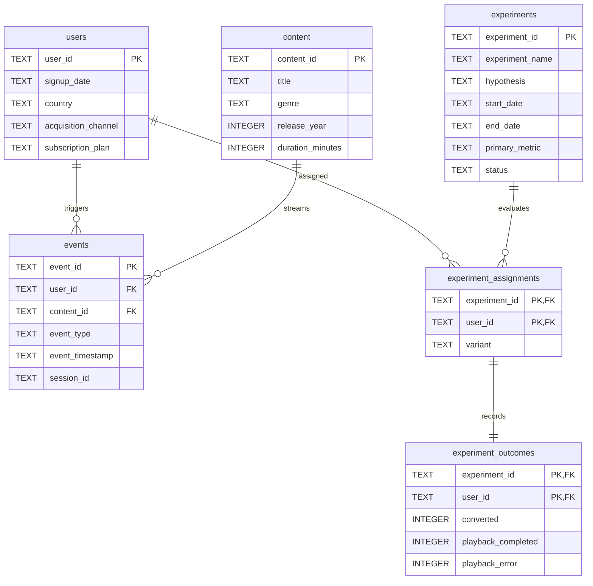

# StreamIQ System Architecture & Technical Design

## 1. High-Level Architecture Overview

StreamIQ is structured as a decoupled, modular product analytics platform designed for high performance, reproducibility, and analytical rigor without external paid cloud dependencies.

```mermaid
flowchart TD
    subgraph Data Foundation
        Gen["Synthetic Data Generator<br/>(src/data_generator.py)"]
        Seed["Fixed Random Seed (42)"]
        DB[("SQLite Storage<br/>(data/streamiq.db)")]
        Seed --> Gen
        Gen -->|Idempotent Bulk Inserts| DB
    end

    subgraph Analytical Core Engine
        Audit["Validation Engine<br/>(src/validation.py)"]
        Analytics["Core Analytics<br/>(src/analytics.py)"]
        Funnel["Funnel Diagnostics<br/>(src/funnel.py)"]
        Ret["Cohort Retention<br/>(src/retention.py)"]
        AB["A/B Testing Lab<br/>(src/experimentation.py)"]
        Recs["Business Insights<br/>(src/recommendations.py)"]
        Rep["Report Engine<br/>(src/reporting.py)"]

        DB --> Audit
        DB --> Analytics
        DB --> Funnel
        DB --> Ret
        DB --> AB
        Analytics --> Recs
        Funnel --> Recs
        Ret --> Recs
        AB --> Recs
        Recs --> Rep
    end

    subgraph User Interface (Streamlit)
        Home["Main Navigation Hub<br/>(app.py)"]
        P1["Executive Command Center<br/>(pages/1_*.py)"]
        P2["User Behaviour Analytics<br/>(pages/2_*.py)"]
        P3["Funnel Analysis<br/>(pages/3_*.py)"]
        P4["Retention & Cohorts<br/>(pages/4_*.py)"]
        P5["A/B Testing Lab<br/>(pages/5_*.py)"]
        P6["Business Recommendations<br/>(pages/6_*.py)"]

        Analytics --> P1
        Analytics --> P2
        Funnel --> P3
        Ret --> P4
        AB --> P5
        Rep --> P6
    end
```

---

## 2. Relational Database Schema & Entity Relationships

The analytical storage is built on SQLite with strict primary keys, foreign key constraints, and performance indexes.



---

## 3. Core Module Responsibilities

| Module | Location | Primary Responsibilities |
| :--- | :--- | :--- |
| **Database** | `src/database.py` | Connection factory, PRAGMA foreign keys, table creation, query execution helpers. |
| **Data Generator** | `src/data_generator.py` | Reproducible seed generation (2,000 users, 100 titles, 60,000+ sequential session events, 2 experiments). |
| **Analytics** | `src/analytics.py` | DAU/WAU/MAU, sessions per user, content/genre rankings, completion rates, 4-tier user segmentation. |
| **Funnel** | `src/funnel.py` | Strict chronological journey verification ($t_{open} \le t_{view} \le t_{start}$), deduplication, drop-off identification. |
| **Retention** | `src/retention.py` | Exact-day retention (D1, D7, D30), incomplete observation window exclusion, weekly/monthly cohort matrix. |
| **Experimentation** | `src/experimentation.py` | Two-proportion z-tests, relative lift, 95% Wald CI, Pearson Chi-Square SRM check, guardrail tracking, decision rules. |
| **Recommendations** | `src/recommendations.py` | Synthesizes computed metrics into actionable findings using a structured product management framework. |
| **Reporting** | `src/reporting.py` | Generates downloadable executive briefing documents (`.md`) and data tables (`.csv`). |
| **Validation** | `src/validation.py` | Automated 6-point data quality test suite auditing primary keys, taxonomy, timestamps, and integrity. |

---

## 4. UI/UX Design System

* **Styling**: Polished SaaS aesthetics (Inter typography, subtle slate borders, clean metric cards).
* **Color Hierarchy**:
  - Primary Action / Volume: Royal Blue (`#2563EB`)
  - Success / Ship / Retention: Emerald Green (`#10B981`)
  - Caution / Investigation: Amber (`#F59E0B`)
  - Danger / Drop-off / Guardrail Breach: Rose Red (`#EF4444`)
* **Plotly Visualizations**: Responsive white template charts (`plotly_white`) with unified tooltips.
* **Simulated Data Notice**: High-visibility disclosure banner embedded across all pages.
